# HeySticky

Personal assistant firmware for the **Seeed reTerminal Sticky** (ESP32-S3, 3.97" e-paper, portrait).
The e-paper screen is a dashboard you read at a glance; you add things by voice or from your phone.

<p align="center">
  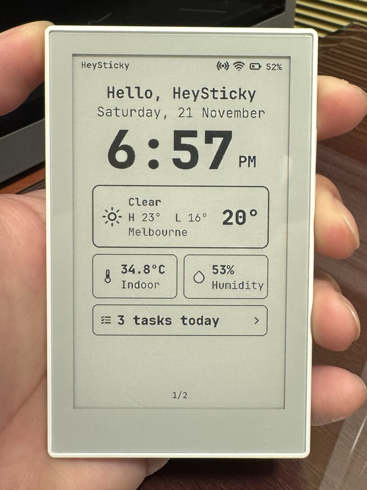
</p>

## Features

Screens below are from the Figma design; the photo above is the real device.

<table>
<tr>
<td width="220">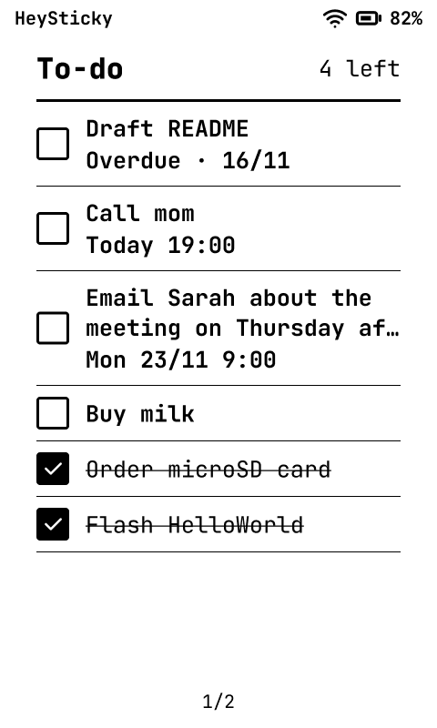</td>
<td><b>To-do.</b> Tap to tick, long-tap to open. Each task can have a deadline (date and/or time) and keeps the
date and time it was created. Pages loop as you swipe. Stored as plain Markdown in <code>/todo.md</code> on the
microSD card.</td>
</tr>
<tr>
<td>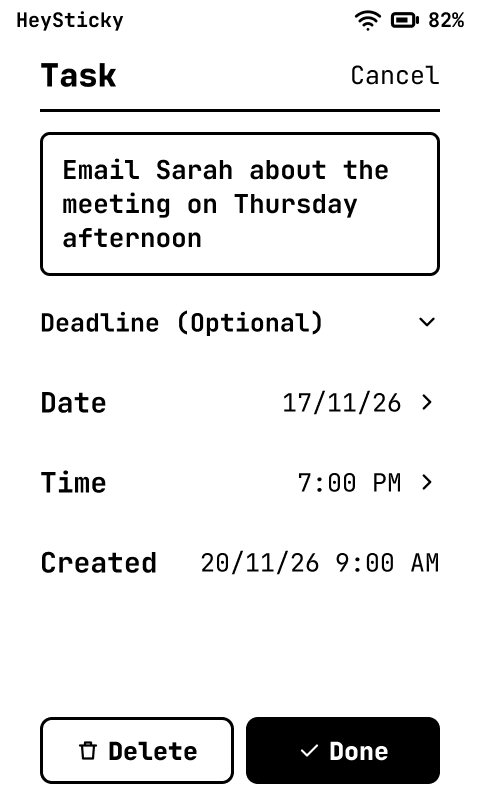</td>
<td><b>Task details.</b> Deadline drop-down with date and 12-hour time, Created stamp, Delete and Done.</td>
</tr>
<tr>
<td>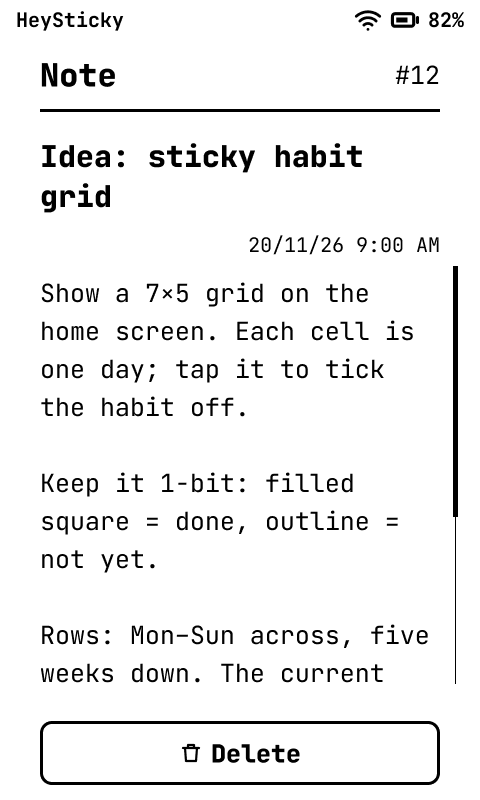</td>
<td><b>Notes.</b> Read (scrolls) and delete on the Sticky; create and edit by voice or on the phone. One Markdown
file per note in <code>/notes/</code>.</td>
</tr>
<tr>
<td>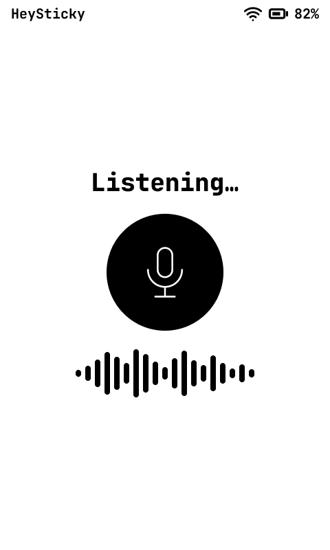</td>
<td><b>AI voice.</b> Hold the top button and talk (up to 60 s). Speech-to-text, then an AI turns it into to-dos
with deadlines ("tomorrow at 9") or a note written your way. English and Vietnamese, also mixed. Needs your own
API key (see <a href="#ai-setup">AI setup</a>).</td>
</tr>
<tr>
<td>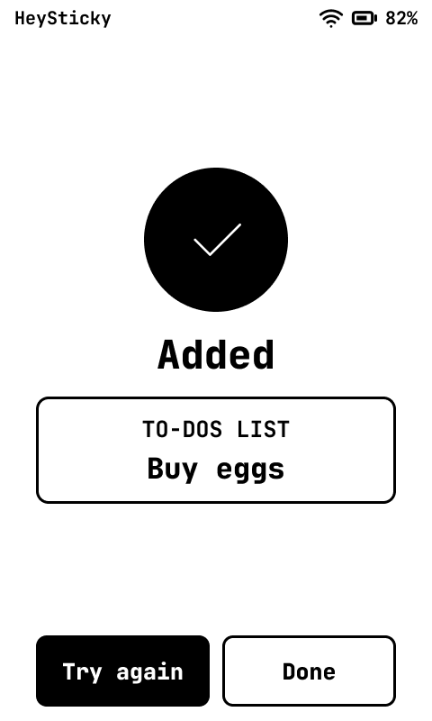</td>
<td><b>Done.</b> The Sticky shows what it saved, with Try again if it got it wrong.</td>
</tr>
<tr>
<td>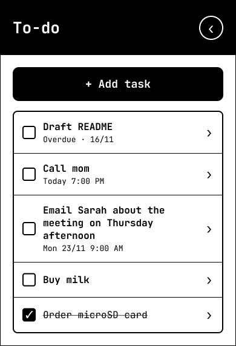</td>
<td><b>Phone To-do and Notes pages.</b> On the Sticky's own hotspot: add, edit, tick and delete; the Sticky
redraws at once.</td>
</tr>
<tr>
<td>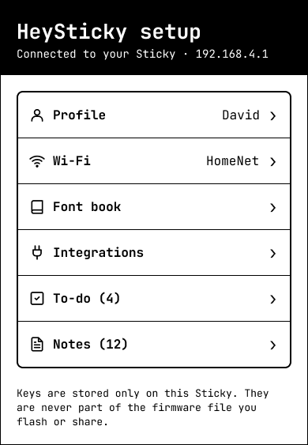</td>
<td><b>Phone setup page.</b> Turn on Web setup, scan the QR code, open <code>192.168.4.1</code>: name, city,
Wi-Fi (up to 5 networks, joined automatically, or a switch to stay offline), fonts and AI keys.</td>
</tr>
<tr>
<td>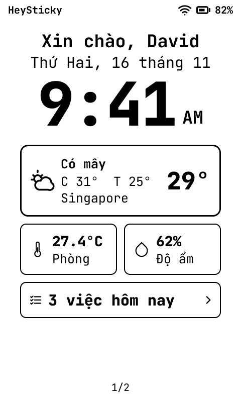</td>
<td><b>English and Tiếng Việt.</b> Every screen and the phone page in both languages. Home shows the clock
(built-in RTC, keeps time with Wi-Fi off, 12-hour AM / PM), weather from Open-Meteo (no API key), indoor
temperature and humidity, and today's to-do count. User fonts can be added from the phone.</td>
</tr>
<tr>
<td>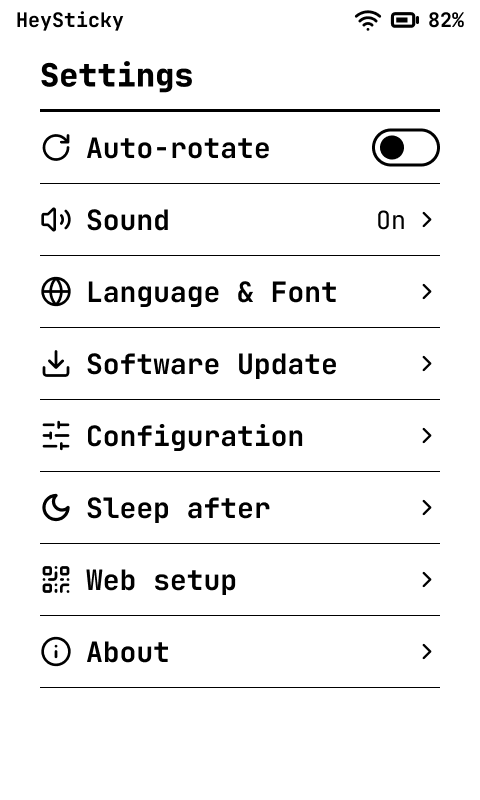</td>
<td><b>Settings.</b> Sound (volume Low / Medium / High), Language &amp; Font, Software Update, Configuration (city,
timezone, °C / °F), Sleep after, Web setup, About (SN, MAC, version, SD card and its files).</td>
</tr>
<tr>
<td>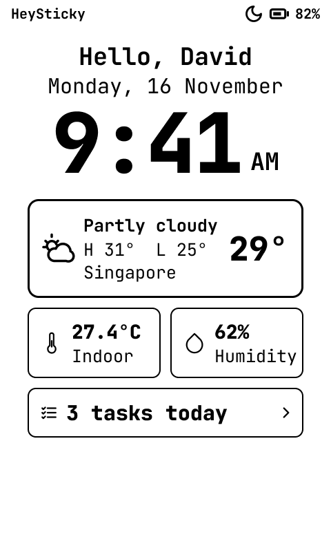</td>
<td><b>Sleep.</b> After 1–10 min idle the Sticky sleeps on Home with a moon; the clock still updates every
minute and the weather every 60 min. UP + DOWN shuts it down; it turns itself off when the battery is empty.</td>
</tr>
<tr>
<td>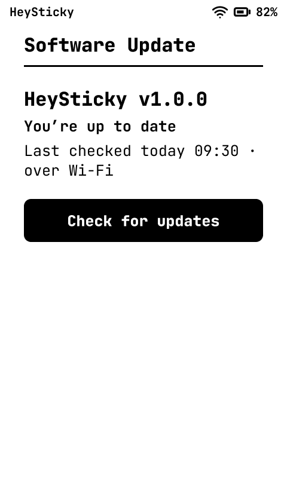</td>
<td><b>Software Update.</b> Checks this repository's GitHub Releases and installs over Wi-Fi, with rollback if the
new version fails to start. Notes, to-dos and settings stay.</td>
</tr>
</table>

## Controls

| Action | How |
|---|---|
| Home | Press the top button, or swipe up from the bottom edge |
| Back | DOWN, or swipe left-to-right |
| Next / previous page (To-do, Notes) | Swipe up / down (pages loop) |
| Scroll a note or SD Files | Swipe, or DOWN = later / UP = earlier |
| Tick a to-do | Tap it |
| Open a to-do | Long-tap it |
| Talk to AI | Hold the top button while you speak (up to 60 s), then let go |
| Wake from sleep | Press the top button |
| Turn off | Hold UP + DOWN together for 3 s |
| Turn on | Hold the top button for 2 s (a short tap does nothing) |

## First setup

1. Insert a microSD card (FAT32) and flash the firmware (below).
2. With no saved Wi-Fi the Sticky opens **Web setup** by itself: scan the QR code with your phone
   (or join `HeySticky-Setup` with the password shown), then open `192.168.4.1`.
3. Set **Profile** (name, city) and **Wi-Fi**. Turn Web setup off on the Sticky when done.

Wi-Fi passwords and settings are kept in the Sticky's flash only. They are never in the source or the `.bin`,
and the setup page is served only on the Sticky's own password-protected hotspot.

## AI setup

The Sticky does no speech recognition itself: your recording goes to a speech-to-text service and the text to a
chat AI. Any OpenAI-compatible service works. The default is one [OpenRouter](https://openrouter.ai) key for both.

1. Sign in at [openrouter.ai](https://openrouter.ai), add a few dollars of credit, then create a key under **Keys**
   (it starts with `sk-or-`).
2. On the Sticky turn on **Web setup** and open `192.168.4.1` on your phone (First setup).
3. **Integrations › AI › Speech-to-text › + Add model provider.** The Base URL and model are filled in
   (`https://openrouter.ai/api/v1`, `mistralai/voxtral-small-transcribe-3-0`); paste your key and tap **Save**.
   The Sticky sends a short test (half a second of silence) and saves the provider only if it answers.
4. **AI for notes & to-dos › + Add model provider.** Leave Base URL and API key empty to use the same
   OpenRouter key; leave Model empty for `deepseek/deepseek-v4.1-flash-1017`. Under **Advanced ›**, **Mode** (Balanced,
   Fastest or Cheapest) tells OpenRouter how to pick the host; turn on **Provider** to name hosts yourself instead.
   Tap **Save** (tested with a one-word chat).
5. Optional, on the same page: **Note instructions** (how notes should be written: an outline, a template or
   rules; typed or uploaded as .txt, up to 2,000 characters) or **Plain text** (save your exact words).

Use the pencil to change a provider and the bin to delete it (its key is removed from the Sticky). To stop a key
working everywhere, also delete it on openrouter.ai.

**Cost:** about $0.80–0.95 a month at 20 memos a day of 15 s each (Voxtral Small ≈ $0.60, DeepSeek V4.1 Flash ≈ $0.18–0.36),
plus OpenRouter's fee when you buy credit (5.5 %, at least $0.80). Prices checked 2026-11-19.

**Privacy:** each recording is sent over HTTPS to the speech-to-text service you set; with OpenRouter it is passed
on to the model's provider, and the Sticky asks OpenRouter for zero-data-retention providers only (models without
one are refused when you tap Save). The transcript, your note instructions, the date, time and language go to the chat
service. Nothing else leaves the Sticky. Keys stay in the Sticky's flash: the phone page only ever shows their first
few characters, and they are never in the source or the `.bin`.

## microSD layout

Plain text, readable on any computer:

```
microSD
├── todo.md                    every to-do, one per line: - [ ] Call the dentist @due(2026-11-17 09:00)
├── notes/
│   └── 012.md                 one note per file: "# Title", then the body
├── fonts/
│   └── <Name>/
│       └── R20.vlw … I25.vlw  user font, one file per size/style, added from the phone page (Font book)
└── ai/
    └── note-instructions.txt  how the AI writes notes, set on the phone page (Integrations › AI)
```

On the Sticky, **Settings › About › SD card › Files** opens the same folders.

## Install

**Seeed Sticky Playground:** flash it in the browser from the Firmware page (once listed).

**From a GitHub Release:** download the files from the latest [release](https://github.com/TaDuy2005/heysticky/releases)
and write them with [esptool](https://github.com/espressif/esptool):

```bash
esptool --chip esp32s3 --baud 460800 write-flash --flash-mode dio --flash-freq 80m --flash-size 32MB \
  0x0 bootloader.bin 0x8000 partition-table.bin 0xe000 boot_app0.bin 0x10000 heysticky.bin
```

Later versions install from **Settings › Software Update** over Wi-Fi; the notes, to-dos and settings stay.

## Build from source

Needs [arduino-cli](https://arduino.github.io/arduino-cli/). The ESP32 core 3.3.12 and ArduinoJson are pinned in
`heysticky/sketch.yaml`. Seeed_GFX2 is not in the Arduino index, so clone it next to the sketch:

```bash
git clone https://github.com/Seeed-Studio/Seeed_GFX2 libs/Seeed_GFX2
git -C libs/Seeed_GFX2 checkout 002798b7b0adc7b3ada8cfd4db6d8a7ca11030f3
```

```bash
tools/build.sh                              # compile
tools/build.sh -u -p /dev/cu.usbmodemXXXX   # compile and upload
tools/release.sh v1.0.0                     # release files + manifest.json into release/v1.0.0/
```

Always build through `tools/build.sh`: it selects the 32 MB flash with two 12.5 MB OTA slots, which an
update can never change later. Host tests for the data formats:

```bash
for t in notes todo settings wifi; do c++ -std=c++17 -I heysticky tools/${t}_test.cpp -o /tmp/${t}_test && /tmp/${t}_test; done
```

The AI test also needs ArduinoJson (installed by the build profile):

```bash
c++ -std=c++17 -I heysticky -I "$(ls -d ~/Library/Arduino15/internal/ArduinoJson_7.4.3_*/ArduinoJson/src)" tools/ai_test.cpp -o /tmp/ai_test && /tmp/ai_test
```

Fonts and icons are generated: `python3 tools/make_fonts.py` (JetBrains Mono TTFs in `fonts/`) and
`python3 tools/make_icons.py` (PNGs in `tools/icons/`). `PLAN.md` is the full design and behaviour spec.

### Releasing an update

1. Raise `FW_VERSION` in `heysticky/settings.h`, commit and push.
2. `tools/release.sh vX.Y.Z`
3. Create GitHub Release `vX.Y.Z` with the files from `release/vX.Y.Z/`. The Sticky downloads the asset named
   `heysticky-app.bin`.

## Roadmap

The full list with details is in [ROADMAP.md](ROADMAP.md).

- **Released:** v1.0 dashboard, To-do, Notes, phone setup, updates over Wi-Fi · v1.1 AI voice · v1.2 phone To-do
  and Notes pages, RTC clock, 12-hour times.
- **Next, v1.3.0 Poster:** one task shown big as a poster with your own picture, set up and pushed from the phone.
- **Then:** choose and arrange the Home cards (widgets).
- **Integrations:** Notion daily sync, Home Assistant, a book reader, deadline reminders, remote access.
- **iPhone app over Bluetooth:** to-dos, notes and fonts without the hotspot.
- **Power:** measure a night on battery, then decide on hourly deep sleep on Home.

## Credits and licences

- HeySticky: MIT, see [LICENSE](LICENSE).
- [Seeed_GFX2](https://github.com/Seeed-Studio/Seeed_GFX2) display library (MIT), Seeed Studio.
- [ArduinoJson](https://arduinojson.org/) (MIT), Benoît Blanchon.
- [JetBrains Mono](https://www.jetbrains.com/lp/mono/) font (SIL Open Font License 1.1, `fonts/OFL.txt`).
- Weather and city search: [Open-Meteo](https://open-meteo.com/) (CC BY 4.0 data).
- Pin map from Seeed's open-source sticky-2048 firmware.
